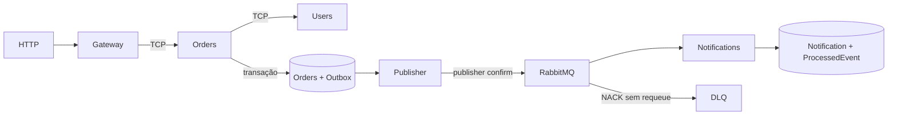

# Microsserviços com NestJS — Etapa 3

**Aluno:** Cayo Toscano  
**Turma:** 36129382024.2n

Esta etapa acrescenta notificações assíncronas ao fluxo de pedidos. O Gateway encaminha chamadas para Users e Orders, enquanto Orders registra o pedido e o evento na mesma transação. Um publicador envia o evento ao RabbitMQ, e o serviço Notifications processa a notificação de forma independente.

## Preparação

Requisitos: Node.js 24, npm e Docker Compose, ou três bancos PostgreSQL e RabbitMQ existentes.

Crie `.env` somente se ainda não existir; se já existir, acrescente as variáveis de `.env.example` sem sobrescrever suas configurações.

```powershell
npm.cmd install
Copy-Item .env.example .env
docker compose up -d --wait
npm.cmd run prisma:generate
npm.cmd run db:deploy
npm.cmd run db:seed
npm.cmd run rabbitmq:setup
```

A Parte 3 mantém os volumes da Parte 2, aplica uma migração adicional em Orders e cria o banco de Notifications.

| Recurso                  | Endereço local                                                           |
| ------------------------ | ------------------------------------------------------------------------ |
| Users PostgreSQL         | `localhost:5432/users_db`                                                |
| Orders PostgreSQL        | `localhost:5433/orders_db`                                               |
| Notifications PostgreSQL | `localhost:5434/notifications_db`                                        |
| RabbitMQ AMQP            | `localhost:5672`                                                         |
| Painel RabbitMQ          | [localhost:15672](http://localhost:15672), usuário `app`, senha `app123` |

As credenciais são apenas de desenvolvimento. Cada domínio usa seu próprio schema, client Prisma 7 e banco. As variáveis são `USERS_DATABASE_URL`, `ORDERS_DATABASE_URL`, `NOTIFICATIONS_DATABASE_URL`, `RABBITMQ_URL` e `RABBITMQ_NOTIFICATIONS_QUEUE`.

Os arquivos Prisma usam caminhos relativos à pasta `prisma`. A CLI possui URLs locais padrão para permitir geração sem banco; os processos exigem a URL correspondente ao seu banco. O seed usa emails únicos, preserva registros existentes e deixa o banco gerar IDs. Consulte `GET /users` para obter os IDs reais. O volume antigo da Parte 1 continua separado.

## Executar

Abra quatro terminais, um comando em cada:

```powershell
npm.cmd run start:users:dev
npm.cmd run start:orders:dev
npm.cmd run start:notifications:dev
npm.cmd run start:dev
```

O modo de desenvolvimento usa `tsx` para resolver `@app/contracts`. Os pipes declaram os DTOs explicitamente, garantindo validação mesmo sem metadados de tipos emitidos pelo executor. O build usa TypeScript e converte aliases em imports relativos para Node ESM.

Para executar os arquivos compilados:

```powershell
npm.cmd run build
npm.cmd run start:users:prod
npm.cmd run start:orders:prod
npm.cmd run start:notifications:prod
npm.cmd run start:prod
```

## Testar uma criação

```powershell
$user = Invoke-RestMethod http://localhost:3000/users -Method Post -ContentType 'application/json' -Body '{"name":"Maria","email":"maria@email.com"}'
$body = @{ userId = $user.id; description = 'Notebook'; total = 4500 } | ConvertTo-Json
Invoke-RestMethod http://localhost:3000/orders -Method Post -ContentType 'application/json' -Body $body
```

O HTTP retorna o pedido sem aguardar a notificação ou a disponibilidade do RabbitMQ. A cada cinco segundos, o publicador consulta a Outbox. Notifications registra o efeito no seu banco e escreve um log com pedido, usuário, total e `eventId`. O envio de email é simulado por esse registro e pelos logs; não há integração externa.



## Eventos e Outbox

`OrderCreatedEvent` contém `eventId`, `orderId`, `userId`, `total` decimal em string e `occurredAt`. O ID é criado uma vez e preservado em republicações. O consumidor usa `@EventPattern('order.created')`, fila durável, ACK manual e `prefetchCount: 1`.

O `OutboxPublisher` roda a cada cinco segundos, seleciona até cinco eventos e usa `FOR UPDATE SKIP LOCKED` para coordenar instâncias. O `RabbitPublisher` publica o envelope Nest `{ pattern, data }`, com mensagem persistente, `mandatory: true` e canal AMQP com publisher confirms. Só depois da confirmação do broker o publicador preenche `publishedAt`. Falhas deixam o evento pendente para outro ciclo.

Esse pequeno lote mantém locks durante a comunicação com o broker; esse custo precisa ser considerado ao escalar. Uma queda depois da publicação e antes do commit pode duplicar eventos. Notifications insere `ProcessedEvent` com chave única e o efeito `Notification` na mesma transação, evitando repetir o efeito de banco mesmo sob concorrência. O ACK ocorre após o commit.

Os logs são ilustrativos e não têm garantia de emissão exatamente uma vez. Um email real exigirá chave idempotente do provedor ou um fluxo persistente de entregas. A fila atende um grupo de consumidores Notifications; entregar o mesmo evento a vários domínios exige uma exchange e filas por assinante.

O exemplo básico de `ClientProxy.emit()` também está disponível:

Use `orderId userId total` e, opcionalmente, `eventId` para testar duplicação.

```powershell
npm.cmd run rabbitmq:emit -- 1 1 4500
```

Esse comando cria somente um evento sintético de laboratório, sem criar pedido. O caminho da aplicação usa Outbox e publisher confirms. Aguardar `emit()` não significa aguardar o processamento da notificação. Confirmações do publicador e ACKs do consumidor têm responsabilidades distintas: [RabbitMQ confirms](https://www.rabbitmq.com/docs/confirms), [Nest RabbitMQ](https://docs.nestjs.com/microservices/rabbitmq).

## DLQ e falhas de laboratório

`rabbitmq:setup` declara `notifications_queue`, a exchange direta `notifications.dlx` e a fila `notifications_dlq`, com routing key `notifications.failed`. Consumidor e publicador asseguram a mesma topologia ao iniciar/publicar. Com uma fila personalizada, os nomes derivam dela, removendo o sufixo `_queue`.

Payload inválido ou falha de processamento recebe `nack(message, false, false)` e vai para a DLQ. Para simular falha, defina `NOTIFICATIONS_SIMULATE_FAILURE=true` no processo Notifications e crie um pedido com total `9999`. O pedido permanece salvo, mas não há registro de notificação. No uso normal, a variável fica `false`.

Após corrigir a causa, republique o corpo original da DLQ na fila principal, preservando o `eventId`, e aguarde a confirmação da republicação antes de confirmar/remover a mensagem da DLQ. O teste real abaixo demonstra esse fluxo.

Falhas do consumidor vão diretamente para a DLQ. Retries automáticos com TTL e limite de tentativas ficam como exercício do tutorial; a Outbox tenta novamente publicações pendentes a cada ciclo. Não há requeue imediato infinito. A DLQ clássica deste laboratório não fornece garantia absoluta de transferência sob todas as falhas do broker; ambientes mais exigentes precisam avaliar quorum queues e políticas de dead-letter.

Se uma fila existente tiver argumentos incompatíveis, o broker rejeita sua declaração. O setup não apaga filas ou mensagens: planeje a mudança de topologia ou use uma fila nova para o laboratório.

## Rotas HTTP e mensagens TCP

| Método | Rota                   | Operação                                       |
| ------ | ---------------------- | ---------------------------------------------- |
| POST   | `/users`               | Criar: `name`, `email`                         |
| GET    | `/users`               | Listar usuários                                |
| GET    | `/users/:id`           | Buscar usuário                                 |
| PATCH  | `/users/:id`           | Atualizar `name` e/ou `email`                  |
| DELETE | `/users/:id`           | Excluir usuário sem pedidos                    |
| POST   | `/orders`              | Criar: `userId`, `description`, `total`        |
| GET    | `/orders`              | Listar pedidos                                 |
| GET    | `/orders/user/:userId` | Listar pedidos do usuário                      |
| GET    | `/orders/:id`          | Buscar pedido                                  |
| PATCH  | `/orders/:id`          | Atualizar `userId`, `description` e/ou `total` |
| DELETE | `/orders/:id`          | Excluir pedido                                 |

Nome e descrição exigem três caracteres. Email deve ser válido e único. IDs são inteiros positivos. Total deve estar entre 0,01 e 99.999.999,99, com no máximo duas casas decimais. O DTO recebe number e o Prisma serializa Decimal como string. Campos extras e valores nulos em atualizações são rejeitados.

Cada domínio expõe as mensagens `create`, `findAll`, `findOne`, `update` e `remove`, por exemplo `users.create`. Orders também expõe `orders.findByUser`.

- Criação: DTO diretamente.
- Busca e exclusão: `{ id: 1 }`.
- Atualização: `{ id: 1, data: { ... } }`.
- Listagem: `{}`; pedidos do usuário: `{ userId: 1 }`.

As fronteiras HTTP e TCP validam dados. O filtro RPC padroniza `{ statusCode, message }`: validação/usuário inválido 400, registro ausente 404, duplicação/usuário com pedidos 409, indisponibilidade 503 e timeout 504. Falhas internas retornam mensagem genérica 500. O Gateway aguarda cinco segundos; chamadas entre serviços aguardam três segundos.

A exclusão de usuários consulta Orders e falha se houver pedidos ou se Orders estiver indisponível. A checagem pode disputar com uma criação concorrente; garantia estrita entre bancos exige protocolo adicional. Não há cascade nem chave estrangeira entre serviços.

## Verificação e migrações

```powershell
npm.cmd test
npm.cmd run test:e2e
npm.cmd run lint
npm.cmd exec tsc --noEmit
npm.cmd run test:messaging
```

`npm test` não exige infraestrutura. Verifica CRUD HTTP/TCP com persistência simulada, erros, timeouts, ACK/NACK, validação de eventos, deduplicação e marcação da Outbox após confirmação.

`test:messaging` compila e inicia quatro processos com PostgreSQL e RabbitMQ reais. Verifica rollback pedido/Outbox, criação com broker indisponível e recuperação, consumidor offline, deduplicação após reinício e sob concorrência, DLQ e reprocessamento. Usa portas e filas temporárias e remove seus próprios registros e recursos. Execute em bancos locais sem outras instâncias Orders ativas; o teste recusa uma Outbox com eventos pendentes.

Para evoluir os schemas:

```powershell
npm.cmd run db:migrate:users -- --name alter_users
npm.cmd run db:migrate:orders -- --name alter_orders
npm.cmd run db:migrate:notifications -- --name alter_notifications
npm.cmd run prisma:generate
```

`db:deploy` aplica migrações versionadas nos três bancos. A migração da Parte 1 permanece em `prisma/migrations` como histórico. As configurações atuais usam as subpastas de cada domínio.

Autenticação, email real, retries do consumidor e retenção/limpeza de Outbox e eventos processados ficam para próximas etapas.
